**你好，我是 Hengyu。把文档里的知识，变成可以追溯和复核的数据。**

[项目 · Projects](#01--正在构建) &nbsp; / &nbsp; [方向 · Focus](#02--关注的方向) &nbsp; / &nbsp; [工具 · Toolkit](#03--工作工具) &nbsp; / &nbsp; [交流 · Connect](#04--一起讨论)

 

## 01 / 正在构建

**[TCM Extract Engine ↗](https://github.com/xiaohengyu8226-png/tcm-extract-engine)**

从 PDF / Markdown 出发，把文档解析、领域规划、结构化抽取、原文核验和人工审核串成一条流水线。支持通用知识与中医安全审方领域，也在探索通过 GEPA 反馈改进提示词。

`文档解析` · `结构化抽取` · `证据追溯` · `人工复核` · `提示词进化`

 

## 02 / 关注的方向

| 方向 | 我正在做的事 |
| :--- | :--- |
| **Document Intelligence** | 让长文档、表格和图片进入同一条可检查的处理流程。 |
| **Knowledge Engineering** | 保留原文、页码与记录之间的联系，让结果有据可查。 |
| **Applied LLM Systems** | 组织模型分工、工件状态与重跑机制，把调用变成系统。 |
| **TCM + AI** | 探索中医药知识的结构化表达，并为专业人员保留复核入口。 |

> 先保留证据，再判断结果。自动核验后，仍然需要人工复核。

 

## 03 / 工作工具

  
  
  
  
  

当前项目围绕 **Python、OpenAI-compatible 模型接口、FastAPI 与 Pydantic** 构建。用 CLI 连接处理步骤，用 Web 工作台检查和修订结果。

 

## 04 / 一起讨论

如果你也在做文档抽取、知识工程或中医 AI，欢迎从一个具体问题开始交流。

**[查看项目](https://github.com/xiaohengyu8226-png/tcm-extract-engine)** &nbsp; · &nbsp; **[提交问题或建议](https://github.com/xiaohengyu8226-png/tcm-extract-engine/issues)** &nbsp; · &nbsp; **[浏览公开仓库](https://github.com/xiaohengyu8226-png?tab=repositories)**

 

Built with care. Designed around evidence.

<!-- Visual resource inspiration: https://github.com/rzashakeri/beautify-github-profile . SVG artwork is original and stored in this repository. -->
